# UniHogar

Proyecto académico de la Universidad Estatal de Bolívar para facilitar la búsqueda y publicación de arriendos estudiantiles en Guaranda.

**Equipo:** Sebastian Velastegui y Neicer Jimenez.

Empieza por la [app Android](https://github.com/CeoF10/unihogar-guaranda) para ver cómo compilarla y conectarla al entorno local. El flujo completo requiere acceso a los módulos privados.

## Arquitectura

```mermaid
flowchart TD
    Android["App Android"] --> API["API REST"]
    Admin["Panel administrativo"] --> API
    API --> DB["PostgreSQL"]
```



## Repositorios

| Módulo | Repositorio | Visibilidad | Tecnologías | Descripción |
| :--- | :--- | :--- | :--- | :--- |
| **App Móvil** | [**`unihogar-guaranda`**](https://github.com/CeoF10/unihogar-guaranda) | **Público** | Kotlin, Jetpack Compose | Aplicación orientada a estudiantes para consultar catálogo de viviendas, ubicación y contacto directo con arrendadores. |
| **Panel Web** | [`unihogar-admin-web`](https://github.com/CeoF10/unihogar-admin-web) | **Privado** | HTML5, CSS3, JavaScript | Dashboard para moderadores y administradores: revisión de publicaciones, gestión de estados y auditoría. |
| **API REST** | [`unihogar-api`](https://github.com/CeoF10/unihogar-api) | **Privado** | Node.js, Express, JWT | Conecta la app y el panel con la base: cuentas, catálogo, fotos, favoritos, expedientes y auditoría. |
| **Persistencia** | [`unihogar-database`](https://github.com/CeoF10/unihogar-database) | **Privado** | PostgreSQL 16, Docker Compose, Adminer | Definición del esquema relacional, migraciones y servicios de base de datos en contenedores. |


## Entorno local

Clona los cuatro repositorios en una misma carpeta. Configura los valores de cada servicio según sus archivos de ejemplo. Arranca primero PostgreSQL y después la API.

### 1. Iniciar Base de Datos y Servicios
```bash
cd unihogar-database
cp .env.example .env
# Edita POSTGRES_PASSWORD antes de iniciar los servicios.
docker compose up -d --wait
```
* Acceso a consola Adminer: `http://localhost:8085`

### 2. Iniciar la API
```bash
cd ../unihogar-api
npm ci
cp .env.example .env   # clave de la base y JWT_SECRET
npm start              # http://localhost:3000/api
```

### 3. Abrir el Panel Web Administrativo
```bash
cd ../unihogar-admin-web
# Abrir index.html en tu navegador o mediante un servidor local (Live Server / Python)
python3 -m http.server 8080
```

### 4. Compilar la App Móvil (Android Studio)
```bash
cd ../unihogar-guaranda
# Abrir en Android Studio y seguir la configuración del README de la app
```
